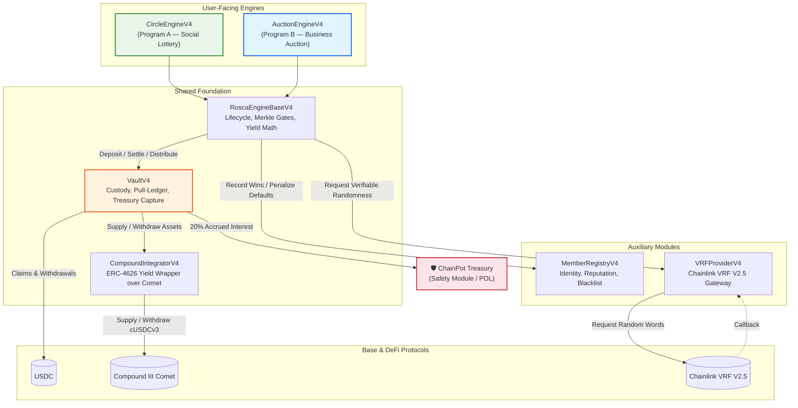

<div align="center">
  
  <h1>ChainPot</h1>
  <p><strong>Decentralized Rotating Savings and Credit Association (ROSCA) Protocol</strong></p>
</div>

> A trust-minimized, yield-bearing rotating savings protocol with two engines — community kitty parties and business ROSCAs — built for the 2 billion people underserved by traditional banking.
> [Read the User Persona & Vision](userpersona.md) • [Certora Audit Remediation Report](smart-contracts/v4/CERTORA_REMEDIATION_REPORT.md)

[](LICENSE)
[](smart-contracts/v4/)
[](smart-contracts/v4/)
[](https://sepolia.basescan.org/)
[](smart-contracts/v4/test/)
[](smart-contracts/v4/CERTORA_REMEDIATION_REPORT.md)

---

## Why ChainPot Exists

Two billion people globally save and access liquidity through **rotating savings and credit associations** — known locally as *chit funds* in India, *susus* in West Africa, *paluwagans* in the Philippines, *tandas* in Mexico, and *kyes* in Korea. These informal financial circles predate modern banking and thrive on interpersonal community trust.

However, traditional ROSCAs face structural vulnerabilities:
- **Default & Counterparty Risk:** Organizers or late-cycle members can default or abscond with pooled funds.
- **Opaque Accounting:** Discount allocation and ledger balancing are manual and prone to fraud.
- **Zero Capital Efficiency:** Idle cash deposited in physical pots earns no yield.
- **Legal Non-Enforceability:** Informal agreements lack recourse in traditional legal systems.

**ChainPot digitizes and secures the ROSCA model on Base:**
1. **Automated & Non-Custodial:** Contributions, bidding, winner selection, and settlements are executed trustlessly via smart contracts.
2. **DeFi Yield Accrual:** Idle cycle contributions automatically generate yield in **Compound III (cUSDCv3)**.
3. **ChainPot Safety Module:** 20% of all accrued Compound interest is channeled into Protocol-Owned Liquidity (POL) to establish an on-chain insurance backstop.
4. **Dual Winner Mechanics:** Verifiable **Chainlink VRF V2.5** lottery draws for social groups, and **competitive discount auctions** for business capital allocation.
5. **Zero-Collateral Social Trust:** Invite-only Merkle tree access control coupled with on-chain reputation scoring and progressive blacklisting.

---

## Protocol Architecture & Dual Engines

ChainPot V4 features two specialized engines built upon a hardened, shared smart contract foundation:



### 🎲 Program A — CircleEngineV4 (Community Kitty Parties)
- **Target Audience:** Social circles, families, communities, and casual savers.
- **Mechanism:** Members contribute a fixed USDC amount per cycle. Winners are selected via **payment-gated per-cycle Chainlink VRF draws** (`H-01`).
- **Incentive:** Every eligible member wins exactly once per pot. Dividends from Compound yield are distributed among participants.

### 🏦 Program B — AuctionEngineV4 (Business ROSCAs)
- **Target Audience:** Small-and-medium enterprises (SMEs), merchants, and entrepreneurs seeking working capital.
- **Mechanism:** Members place competitive discount bids in a reverse auction. The lowest bidder receives the pot early at their bid amount.
- **Dividend Distribution:** The remaining pot balance (discount + net Compound yield) is distributed to patient non-winning members as a high-yield dividend.

---

## Detailed Contract Responsibilities

| Contract | Primary Role | Key Innovations & Security Protections |
| :--- | :--- | :--- |
| **`RoscaEngineBaseV4`** | Shared ROSCA lifecycle state machine | Merkle invite gate, frozen roster, time-weighted gross yield accounting, L-02 zero-gross-yield equal fallback, retry fallback winner protection (`F-09`), cycle cadence enforcement (`F-08`). |
| **`CircleEngineV4`** | Program A: Social Lottery Engine | Payment-gated per-cycle VRF draws (`H-01`), 2-step store-then-finalize settlement (`F-01`), single-payer direct winner assignment without VRF overhead. |
| **`AuctionEngineV4`** | Program B: Business ROSCA Engine | Strict 2% minimum bid step (`M-03`), strictly-lower re-bids (`M-01`), bidding blocked during payment window (`F-10`), `totalCollected` bid ceiling (`H-03`). |
| **`VaultV4`** | Non-custodial treasury & pull payments | Time-weighted cycle funds tracking, 20% protocol safety fee routing, zero-stranded-backing invariant (`backing == 0`), timelocked engine authorization (`F-03`). |
| **`CompoundIntegratorV4`** | Compound III (cUSDCv3) wrapper | Live asset float queries (`L-01`), virtual offset against inflation/donation attacks (`H-05`), full removal of inaccurate `internalPrincipal` (`L-09`), asset rescue guards (`L-04`), one-time vault binding (`F-03`). |
| **`MemberRegistryV4`** | Identity, reputation & blacklist | Activity timestamp tracking (`L-07`), repeat-default blacklist enforcement (`F-05`), single-bid reputation anti-manipulation (`M-02`). |
| **`VRFProviderV4`** | Chainlink VRF V2.5 Coordinator Gateway | Authorized requester allowlist (`C-03`), 2.5M subscription ID support, decoupled random word storage from execution. |

---

## Mathematical Formulations & Yield Distribution

### 1. Exact Time-Weighted Member Yield (`L-02`)

In any cycle with gross harvested assets `grossHarvested`, total minted shares `totalSharesMinted`, member shares `S_i`, and member contribution `C_i`:

```
memberAssets_i = (grossHarvested * S_i) / totalSharesMinted
memberGrossYield_i = max(0, memberAssets_i - C_i)
totalGrossYield = sum(memberGrossYield_i)
```

### 2. Dividend & Fallback Math

For net interest `netYield` (after 20% Treasury cut):

- **Standard Case (`totalGrossYield > 0`):**
  ```
  memberNetYield_i = (netYield * memberGrossYield_i) / totalGrossYield
  ```

- **Zero-Gross-Yield Fallback Case (`totalGrossYield == 0 && n > 0`):**
  If non-winning recipients in an Auction pot (or depositors in a Circle pot) have zero calculated gross yield:
  ```
  equalYieldShare = netYield / n
  memberNetYield_i = equalYieldShare
  dust = netYield - (n * equalYieldShare)
  ```

The base discount is distributed equally (`discount / n`), member yield is distributed equally (`netYield / n`), and only division rounding dust (<= n wei) is credited to `recipients[0]`.

---

## Comprehensive Security & Audit Remediation

ChainPot V4 has undergone extensive security reviews and formal remediation incorporating findings from Certora and internal audit teams.

```
┌─────────────────────────────────────────────────────────────────────────────┐
│                          48 / 48 TESTS PASSING (100%)                       │
│  [PASS] High Severity Remediations (H-01 .. H-05)                           │
│  [PASS] Medium Severity Remediations (M-01 .. M-06)                         │
│  [PASS] Low Severity Remediations (L-01 .. L-10)                            │
│  [PASS] Informational Fixes (I-01 .. I-06)                                  │
│  [PASS] Architecture & Scaling Review (F-01 .. F-14)                        │
│  [PASS] Base Mainnet Fork Integration Tests (ForkCometTest)                 │
└─────────────────────────────────────────────────────────────────────────────┘
```

### Remediation Highlights:
- **`H-01` (Unfunded VRF Drain):** Replaced initial pre-shuffle VRF with payment-gated per-cycle draws (`_drawGated()`). VRF is only requested when >= 2 members have funded the cycle.
- **`L-02` (Auction Zero-Gross-Yield Fallback):** Equal fallback division ensures net yield is split fairly among non-winning members rather than collapsing into a single recipient.
- **`L-09` (Redundant `internalPrincipal` Removed):** Removed inaccurate tracking state; partial withdrawals withdraw exact pro-rata Comet shares.
- **`I-04` (Sweep Reward Authorization):** Restricted `sweepReward(address)` to `onlyOwner`.
- **`F-01` (VRF Gas Ceiling):** Implemented 2-step store-then-finalize pattern. VRF callback stores random seed; permissionless `finalizeDraw()` completes settlement in an ordinary transaction (tested for 100-member pots).
- **`F-03` (Custody Hardening):** `CompoundIntegratorV4.setVault()` is a one-time binding; `VaultV4.lockEngineSetup()` permanently locks immediate engine additions.
- **`F-10` (Auction Bidding Lock):** Bidding is strictly blocked during the payment window and opens only after payment deadline expiration.

---

## Live on Base Sepolia (`chainId 84532`)

The entire V4 stack is deployed, wired, and verified on **Base Sepolia**:

| Contract Name | Deployed Address | Basescan Explorer |
| :--- | :--- | :--- |
| **`MemberRegistryV4`** | `0x5860dDEE64256Cf77924209b1eEEb4ddf92B3395` | [View on Basescan](https://sepolia.basescan.org/address/0x5860dDEE64256Cf77924209b1eEEb4ddf92B3395) |
| **`VRFProviderV4`** | `0x02C179C8ddD881Ae61C50D06440a849EFCBEf504` | [View on Basescan](https://sepolia.basescan.org/address/0x02C179C8ddD881Ae61C50D06440a849EFCBEf504) |
| **`CompoundIntegratorV4`** | `0xa530364AfcEFeB70938Ec2D1aDdc1f64410610B6` | [View on Basescan](https://sepolia.basescan.org/address/0xa530364AfcEFeB70938Ec2D1aDdc1f64410610B6) |
| **`VaultV4`** | `0x3D5dd83A9977BBEA876F9380cfd56A6B9E064C95` | [View on Basescan](https://sepolia.basescan.org/address/0x3D5dd83A9977BBEA876F9380cfd56A6B9E064C95) |
| **`CircleEngineV4`** | `0x8EA7cdD4Ae50FC8BF99a76eD182F0665710D81Db` | [View on Basescan](https://sepolia.basescan.org/address/0x8EA7cdD4Ae50FC8BF99a76eD182F0665710D81Db) |
| **`AuctionEngineV4`** | `0x347B063538219961a747192d0656c1b4e382Da2e` | [View on Basescan](https://sepolia.basescan.org/address/0x347B063538219961a747192d0656c1b4e382Da2e) |
| **`USDC`** | `0x036CbD53842c5426634e7929541eC2318f3dCF7e` | [View on Basescan](https://sepolia.basescan.org/address/0x036CbD53842c5426634e7929541eC2318f3dCF7e) |
| **`Compound III cUSDCv3`**| `0x571621Ce60Cebb0c1D442B5afb38B1663C6Bf017` | [View on Basescan](https://sepolia.basescan.org/address/0x571621Ce60Cebb0c1D442B5afb38B1663C6Bf017) |

### Live Testnet Verified Transactions:
- **Circle Pot Program (Program A):**
  - Pot Created: [`0xa68578bd...`](https://sepolia.basescan.org/tx/0xa68578bda93e6b045bf8a1d0083e45792ec74edaadfcff1d2df2171365cf78fe)
  - Member 1 Join: [`0x1258ab56...`](https://sepolia.basescan.org/tx/0x1258ab56e2191311a0546e467346a8b893deefd85af816813edbc88e4da30622)
  - Member 2 Join: [`0x77dab077...`](https://sepolia.basescan.org/tx/0x77dab077e4d011b0387c1459191bb9e60812d2a2fc711aa60e57c9ae94a1c39c)
  - Pot Started: [`0x215c6510...`](https://sepolia.basescan.org/tx/0x215c6510b3b3a3d7d83f65f840310b91b1d3051a6f6f21410dbf34920f35f6d1)
  - Cycle 1 Started: [`0xd8ddd5c6...`](https://sepolia.basescan.org/tx/0xd8ddd5c651b8113d4ac04e6d8d2b362f4d28fd2842f15be8217e0d4ce86dea9d)
  - Member 1 Deposit: [`0xaaa57da5...`](https://sepolia.basescan.org/tx/0xaaa57da5575500c312e9fe4ced4d8d744e466fb6c32a57ca99ae2bce755e0b3b)
  - Member 2 Deposit: [`0xc34ccc35...`](https://sepolia.basescan.org/tx/0xc34ccc35e0c09048fccf44fbe0bec75f458e6d233cd5ac338b6ad5ff900ad54d)
- **Auction Pot Program (Program B):**
  - Pot Created: [`0x513030b8...`](https://sepolia.basescan.org/tx/0x513030b832a985199875c078dc0db9327c39b9966febc75bae2d36265d9b8220)
  - Member 1 Join: [`0x620fcb75...`](https://sepolia.basescan.org/tx/0x620fcb75d3ada234ef6da6ece365d5b396961e82736c4cb1e7096249709a78b2)
  - Member 2 Join: [`0x7883f0ef...`](https://sepolia.basescan.org/tx/0x7883f0ef5258aae3df4fce4cb61ae329fca4775d8d4cd9fa903cbd50bb70f89f)
  - Pot Started: [`0x9071bf7a...`](https://sepolia.basescan.org/tx/0x9071bf7ad2ad3436cc8eaa80e32e7fee5117ad39d36c003b0bc38cc4ec0df989)
  - Cycle 1 Started: [`0xb3d48a1e...`](https://sepolia.basescan.org/tx/0xb3d48a1e97dc0c1fe24cdcd34dfce1a2d4fe371d5a8f4ef9463b41afe4b26d05)
  - Member 1 Deposit: [`0x779519e4...`](https://sepolia.basescan.org/tx/0x779519e43d3ecd474453f5f3135358e9aa096b92a98afc6ffd58b61079679708)
  - Member 2 Deposit: [`0xb400c8f3...`](https://sepolia.basescan.org/tx/0xb400c8f30b8d8b5d411ab075ec7fb88cc3416afe50fd676631a5b1a3bccd0417)
  - F-10 Enforcement: Bidding during payment window rejected with `BiddingNotOpen`

---

## Getting Started

### 1. Smart Contract Development & Testing

```bash
cd smart-contracts/v4

# Build contracts
forge build

# Run all 48 unit, regression, and remediation tests
forge test

# Run fork test against live Base Mainnet Compound III
forge test --match-contract ForkCometTest --fork-url https://mainnet.base.org -vv
```

### 2. Deploying to Base Sepolia

```bash
cd smart-contracts/v4

# Configure environment variables in .env
# PRIVATE_KEY=0x...
# USDC_BASE_SEPOLIA=0x036CbD53842c5426634e7929541eC2318f3dCF7e
# COMET_USDC_BASE_SEPOLIA=0x571621Ce60Cebb0c1D442B5afb38B1663C6Bf017
# VRF_COORDINATOR_BASE_SEPOLIA=0x5C210eF41CD1a72de73bF76eC39637bB0d3d7BEE
# VRF_KEYHASH_BASE_SEPOLIA=0x9e1344a1247c8a1785d0a4681a27152bffdb43666ae5bf7d14d24a5efd44bf71
# VRF_SUBSCRIPTION_ID=95007054372769189896522520864557247936870864063300209685082674604833762333346

# Execute deployment script
forge script script/DeployV4.s.sol --rpc-url https://base-sepolia-rpc.publicnode.com --broadcast --slow --legacy
```

### 3. Frontend Application

```bash
cd Frontend

# Install dependencies
npm install

# Run local development server
npm run dev

# Production build
npm run build
```

---

## Repository Structure

```
chainpot/
├── README.md                           ← Project overview & documentation
├── userpersona.md                      ← User personas, vision & product design
├── Frontend/                           ← Next.js 16 (Turbopack) + Wagmi + RainbowKit dApp
│   ├── app/                            ← App router pages & layouts
│   ├── components/                     ← React components & UI design system
│   ├── config/hooksConf.ts             ← ABIs & Base Sepolia contract addresses
│   └── hooks/                          ← Custom React hooks for V4 contracts
└── smart-contracts/
    └── v4/                             ← Production V4 smart contracts
        ├── CERTORA_REMEDIATION_REPORT.md← Formal audit remediation design doc
        ├── DEPLOYMENT.md               ← Deployment addresses & verification log
        ├── foundry.toml                ← Foundry configuration
        ├── src/                        ← Core Solidity contracts
        │   ├── RoscaEngineBaseV4.sol   ← Shared lifecycle & yield math
        │   ├── CircleEngineV4.sol      ← Program A (Lottery engine)
        │   ├── AuctionEngineV4.sol     ← Program B (Discount auction engine)
        │   ├── VaultV4.sol             ← Custody, ledger & treasury fee capture
        │   ├── CompoundIntegratorV4.sol← Yield vault over Compound III Comet
        │   ├── MemberRegistryV4.sol    ← Identity, reputation & blacklisting
        │   └── VRFProviderV4.sol       ← Chainlink VRF V2.5 Coordinator wrapper
        ├── test/                       ← 48 automated test suites
        └── script/                     ← Deployment & testnet execution scripts
```

---

## Acknowledgements

- **Compound Finance** for Compound III Comet — enabling clean, real-time supply yield integration.
- **Chainlink** for VRF V2.5 — providing cryptographically verifiable on-chain randomness.
- **OpenZeppelin** for battle-tested ERC-20, SafeERC20, ReentrancyGuard, and MerkleProof primitives.
- **Base** for low-latency, scalable Ethereum L2 infrastructure.

---

## License

This project is licensed under the [MIT License](LICENSE).
